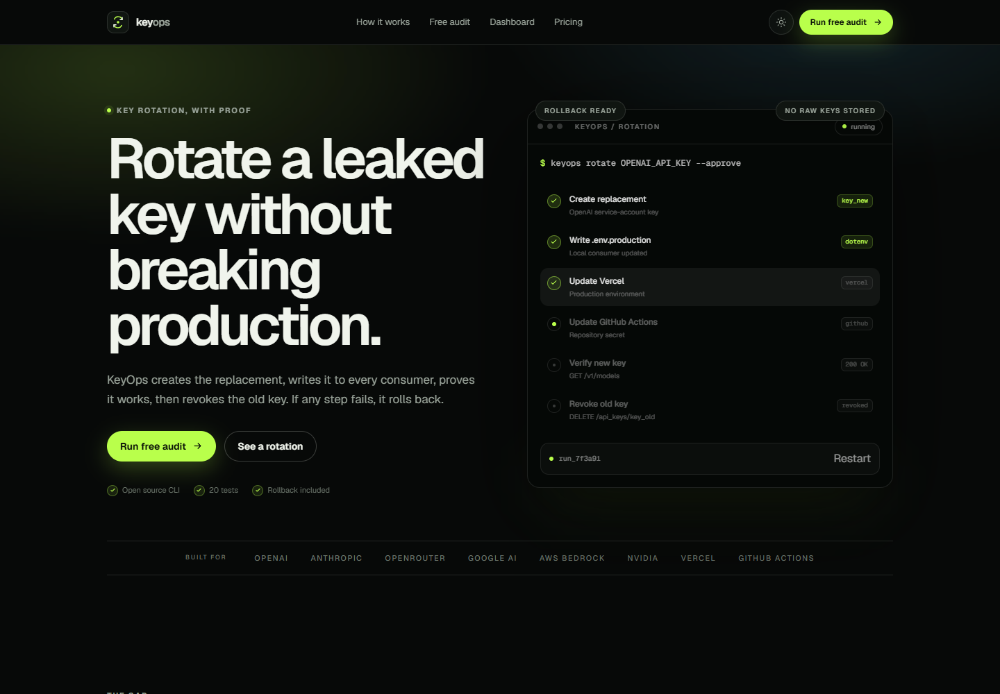
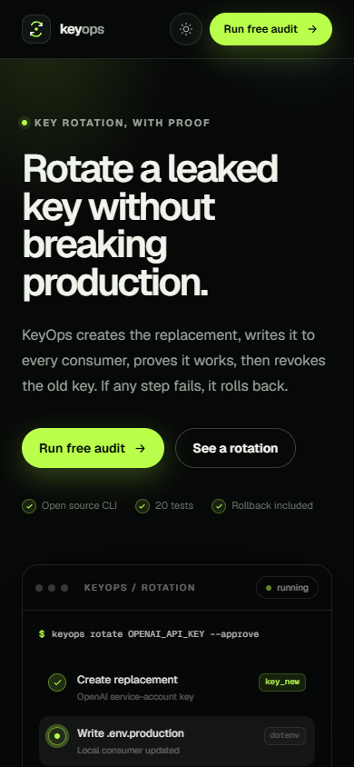
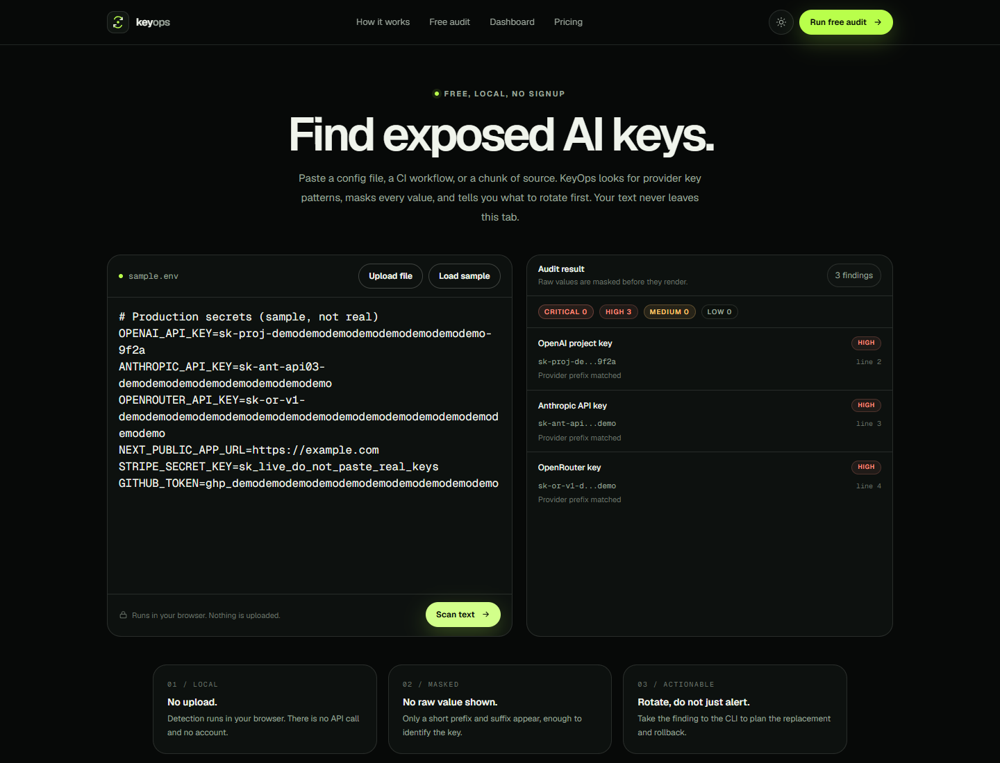
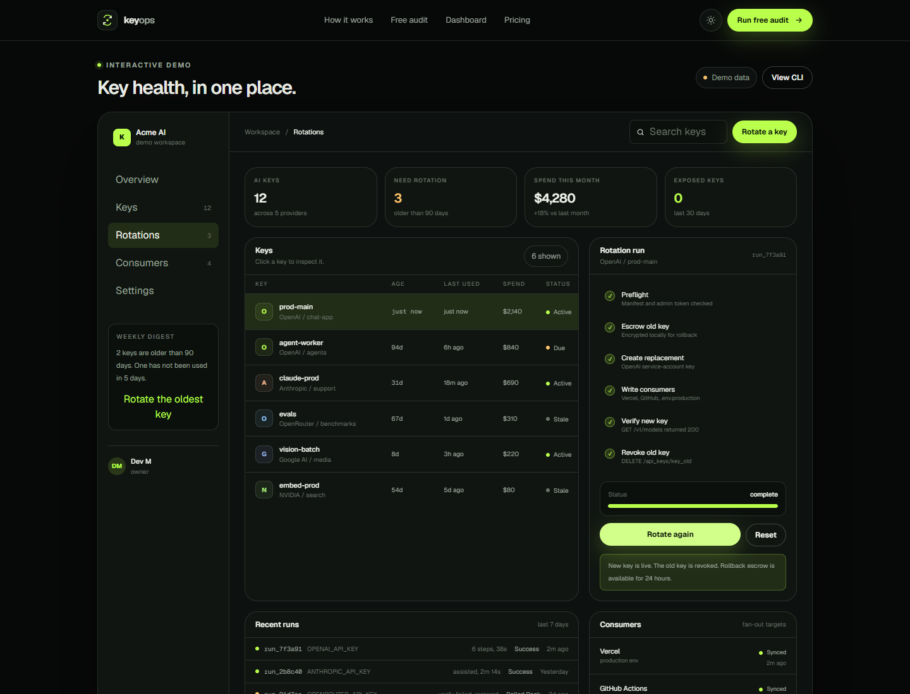

# KeyOps

**Rotate a leaked AI key without breaking production.**

KeyOps is an open-source command-line tool with a web dashboard for one narrow task: replace an AI API key everywhere it lives, prove the replacement works, then revoke the old key. If any step fails, it restores the old key from encrypted escrow.

[](https://github.com/devtechedge/keyops/actions/workflows/ci.yml)
[](LICENSE)
[](https://nodejs.org)
[](#limitations)



## The gap

Finding an exposed key is the easy part. Replacing one credential across a local env file, Vercel, GitHub Actions, and a provider console without taking production down is the hard part. Most scanners stop at the alert. Most gateways ask you to move your traffic.

KeyOps changes the secret where it already lives:

- **Fan out:** write the replacement to every consumer in order.
- **Verify:** make a real request with the new key before revoking the old one.
- **Roll back:** restore the old key to every consumer if a step fails.
- **Keep it local:** raw values never go to a KeyOps server. The CLI stores only encrypted escrow.

## Quick start

Requires Node.js 20 or newer.

Run it without cloning:

```bash
npx github:devtechedge/keyops#main --help
```

Or work from source:

```bash
git clone https://github.com/devtechedge/keyops.git
cd keyops
npm install
npm run build
node dist/cli.js --help
```

Link the command once if you want to use `keyops` from anywhere:

```bash
npm link
keyops audit .
```

The web app lives in `web/` and runs on Next.js:

```bash
npm run web:dev
```

Live site: [keyops-teal.vercel.app](https://keyops-teal.vercel.app)

## How a rotation works

```bash
keyops init
keyops plan OPENAI_API_KEY
keyops rotate OPENAI_API_KEY --approve
```

`rotate` is a transaction, not a script:

1. **Preflight:** validate the manifest and admin token, then lock the run.
2. **Escrow:** encrypt the old key and consumer values locally.
3. **Create:** create a scoped replacement key with an expiry where the provider supports it.
4. **Fan out:** write the new value to each consumer in order.
5. **Verify:** call the provider's verify endpoint and expect the configured status.
6. **Revoke:** deactivate the old key only after verification passes.

If a consumer fails, the run stops and restores the old value to every consumer it touched. The failure is recorded with the exact step.

## Supported providers

| Provider | Inventory | Create | Delete | Verify | Notes |
| --- | --- | --- | --- | --- | --- |
| OpenAI | Yes | Yes | Yes | Yes | Admin API creates project service-account keys with scopes and expiry. |
| OpenRouter | Yes | Yes | Yes | Yes | Provisioning API creates and deletes keys. |
| Anthropic | Yes | Assisted | Yes | Yes | Create the replacement in the console. KeyOps writes, verifies, then deactivates the old key. |
| Google AI / Vertex | Partial | Assisted | Assisted | Yes | Service-account lifecycle runs through IAM. Use a custom verify URL. |
| AWS Bedrock | Partial | Assisted | Assisted | Yes | IAM access-key lifecycle. Use a custom verify URL. |
| NVIDIA | Partial | No | No | Yes | Rotate in the NVIDIA console. KeyOps can fan out and verify. |
| Other | Partial | No | No | Yes | Bring a custom verify URL and rotate manually. |

Consumers supported today:

- **dotenv:** preserves comments, quotes, and existing values.
- **Vercel:** updates environment variables through the Vercel API.
- **GitHub:** updates repository Actions secrets through the GitHub API.

## Manifest

Create `.keyops.yml` with `keyops init`. A starter looks like this:

```yaml
version: 1
secrets:
  OPENAI_API_KEY:
    provider: openai
    project: proj_your_project
    serviceAccount: svc_your_service_account
    keyId: key_your_current_key
    consumers:
      - type: dotenv
        path: .env.local
      - type: vercel
        project: your-vercel-project
        target:
          - production
      - type: github
        repo: your-org/your-repo
        secret: OPENAI_API_KEY
    verify:
      url: https://api.openai.com/v1/models
      auth: bearer
      expect: 200
    keepOld: 24h
```

Commit the manifest. Do not commit real keys. The `keyId` is an identifier, not the secret value.

## CLI

| Command | What it does |
| --- | --- |
| `keyops audit [path]` | Scan tracked files, env files, and config for AI key patterns. |
| `keyops plan <secret>` | Show the ordered rotation plan without changing anything. |
| `keyops rotate <secret> --approve` | Create, fan out, verify, and revoke. |
| `keyops rollback <run-id>` | Restore the old key from encrypted escrow. |
| `keyops verify <secret>` | Check a key against its verify endpoint. |
| `keyops providers` | Show provider capabilities. |
| `keyops connect <provider>` | Store an admin token in the OS keyring. |
| `keyops disconnect <provider>` | Remove a stored admin token. |
| `keyops runs` | List recent local runs. |
| `keyops doctor` | Check configuration and credentials without printing secrets. |

Useful flags:

```bash
keyops audit . --fail-on high
keyops audit . --json
keyops rotate OPENAI_API_KEY --approve --no-verify
keyops plan OPENAI_API_KEY --manifest path/to/.keyops.yml
```

Prefer environment variables over command-line values for sensitive input:

```bash
KEYOPS_OLD_KEY=... KEYOPS_NEW_KEY=... keyops rotate OPENAI_API_KEY --approve
KEYOPS_VERIFY_KEY=... keyops verify OPENAI_API_KEY
```

## Security model

- The browser audit runs entirely in the tab. It masks values before render and makes no API call.
- The CLI stores admin tokens in the operating system keyring through `@napi-rs/keyring`, or reads them from environment variables.
- Rotation escrow is encrypted with AES-256-GCM under `~/.keyops/escrow`. The key lives in `~/.keyops/escrow.key` or `KEYOPS_ESCROW_KEY`. Set `KEYOPS_HOME` to move the directory.
- Run records are written under `~/.keyops/runs`; consumer backups are written under `~/.keyops/backups`.
- Vercel and GitHub secret values are write-only. KeyOps needs the old key from a dotenv consumer, `--old-key`, `KEYOPS_OLD_KEY`, or a hidden prompt before it can escrow.
- The hosted dashboard is a demo. It uses mock data. The CLI and rotation engine are the real implementation.

## Web app

| Landing | Audit | Dashboard |
| --- | --- | --- |
|  |  |  |

The web app includes:

- A dark and light theme with no layout shift.
- A browser audit with file upload, sample data, severity counts, and masked values.
- An interactive rotation demo with step progress, consumer status, recent runs, and rollback copy.

## Development

```bash
npm install
npm run typecheck
npm test
npm run build
npm run web:build
npm run ci
```

The test suite covers detection patterns, directory scanning, manifest validation, dotenv preservation, and rotation rollback. It currently has 20 tests across 5 files.

Project layout:

```text
src/
  cli.ts                 command wiring
  core/
    providers/           OpenAI, Anthropic, OpenRouter
    consumers/           dotenv, Vercel, GitHub
    rotation.ts          transaction, escrow, rollback
    scanner.ts           key detection
web/                     Next.js landing, audit, and dashboard demo
docs/screenshots/        product screenshots
```

## Agent workflows

The repository ships project-scoped agent skills under `.opencode/skills/`:

- `dev-memory` and `refine` for project context.
- `curator`, `journey`, and `learn` for skill maintenance.
- `oss` for upstream contribution work.
- `github-repo-presentation` for public repository polish.

They are plain Markdown with no runtime dependency. Read `.opencode/skills/README.md` for the index.

## Limitations

- Pre-1.0. The manifest schema and CLI flags may change.
- Anthropic key creation is assisted because its API does not expose key creation.
- Vercel and GitHub do not return existing secret values, so the old key must be supplied for escrow.
- Google, AWS, and NVIDIA rotation is manual or assisted. KeyOps can still fan out and verify.
- The hosted dashboard does not persist data or run rotations yet.
- Do not run `rotate` on a production key until you have tested `plan`, `verify`, and `rollback` in a non-production project.

## Contributing

See [CONTRIBUTING.md](CONTRIBUTING.md). Security reports: see [SECURITY.md](SECURITY.md).

## License

MIT. See [LICENSE](LICENSE).
